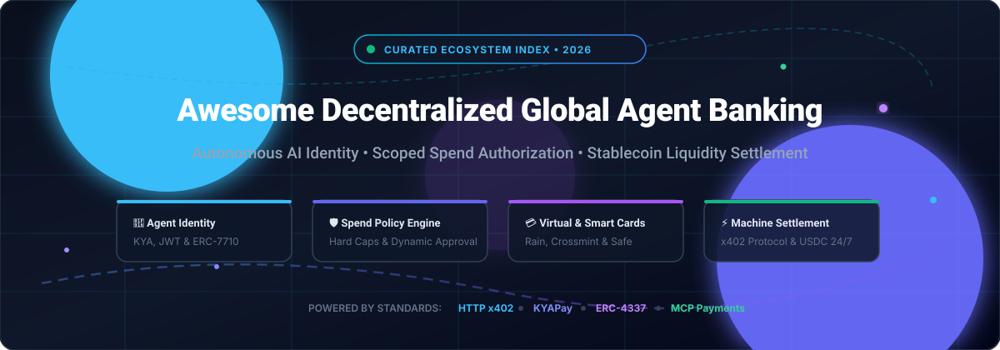

<div align="center">

# 🌐 Awesome Decentralized Global Agent Banking Platforms

<p align="center">
  
</p>

<a href="https://github.com/ishandutta2007/Awesome-Awesome-Awesome"></a><a href="https://discord.gg/jc4xtF58Ve"></a>
[](https://awesome.re)
[](https://opensource.org/licenses/MIT)
[](#)
<a href="https://github.com/ishandutta2007"></a>

<p align="center">
  <strong>Curated index of decentralized global agent banking platforms, scoped spend authorization protocols, autonomous AI wallet infrastructure, and stablecoin settlement rails.</strong>
</p>

<p align="center">
  🤖 <em>Identity</em> • 🛡️ <em>Spend Governance</em> • 💳 <em>Virtual Cards</em> • ⚡ <em>x402 &amp; Stablecoins</em>
</p>

</div>

---

## 🏛️ Top Decentralized Global Agent Banking Platforms Ecosystem

**Curated List of SaaS Products & Open-Source GitHub Projects**  
*Focused on Agent Identity, Scoped Spend Authorization & Stablecoin Settlement*  
📅 **Last updated: March 2026**

This repository tracks notable **SaaS platforms** and **open-source projects** for **Decentralized Global Agent Banking** and **Agentic Commerce**. These tools enable autonomous AI agents to hold verifiable identities, receive programmable funds, spend within strict policy-defined boundaries, and settle transactions across fiat and crypto rails—without exposing permanent payment credentials or private keys.

**Core architectural pillars:**
- 🆔 **Agent Identity & Authentication:** Cryptographic agent credentials, KYA (Know Your Agent), and machine-to-machine delegation tokens.
- 🛡️ **Scoped Spend Governance:** Deterministic pre-execution policy enforcement (per-transaction caps, daily budgets, vendor allowlists, human-in-the-loop triggers).
- ⚡ **Stablecoin & Multi-Rail Settlement:** Sub-second 24/7/365 liquidity settlement via USDC/USDT on Base, Solana, Ethereum, and Lightning/fiat virtual accounts.

🤝 Contributions welcome! Open a PR to add or update entries.

---

## 📑 Table of Contents

- [📊 Sector Overview & Market Dynamics](#-sector-overview--market-dynamics)
- [☁️ SaaS & Hosted Platforms](#️-saas--hosted-platforms)
- [🔓 Open-Source GitHub Projects](#-open-source-github-projects)
- [📜 Emerging Protocols & Standards](#-emerging-protocols--standards)
- [🏗️ Architecture & Implementation Blueprint](#️-architecture--implementation-blueprint)
- [⭐ Star History](#-star-history)
- [💖 Support](#-support)
- [🤝 How to Contribute](#-how-to-contribute)
- [⚠️ Disclaimer](#️-disclaimer)

---

## 📊 Sector Overview & Market Dynamics

The global AI agent market is valued at approximately **$7.8B–$8.0B** and projected to exceed **$50B by 2030**, while agentic commerce and autonomous machine-to-machine transaction spend are estimated to scale between **$1.5T and $3.0T+** globally by 2030.

The sector exhibits a **bifurcated market structure**:
- 🏛️ **Core Infrastructure Layer (Consolidated / Oligopolistic):** Foundational settlement networks and licensed compliance rails are rapidly concentrating around global payment giants and infrastructure unicorns (Stripe/Bridge, Mastercard/BVNK, Visa, and Circle), where regulatory moats, principal card memberships, and fiat-clearing pipelines create natural winner-take-most dynamics.
- 🧩 **Agent Orchestration & Protocol Edge (Moderately to Highly Fragmented):** Application-specific tooling, open spend-governance engines, prompt-level checkout adapters, and autonomous wallet SDKs remain highly fragmented across specialized frameworks, decentralized protocols (x402, KYAPay, ERC-7710/4337), and developer ecosystems.

---

## ☁️ SaaS & Hosted Platforms

| Platform | 🏢 Company Valuation / Scale | 💰 Pricing | 🎁 Free Tier / Trial Limits | 📝 Description |
| :--- | :--- | :--- | :--- | :--- |
| **[Rain Cards](https://www.rain.xyz/)** | $1.95B Valuation (Jan 2026, Series C; $338M raised; $3B+ annualized volume) | Interchange revenue share on Visa card spend + platform fee tiers; 0% APR, up to 3% FX | Free sandbox developer testing environment with pre-allocated test credits | Scoped virtual card issuance infrastructure for autonomous AI agents. Creates ephemeral virtual cards in milliseconds against strict spend constraints, automatically retiring cards post-transaction. |
| **[BVNK](https://bvnk.com/)** | $1.8B Valuation (Acquired by Mastercard Mar 2026; $90M+ raised; $40M+ ARR) | Volume-tiered enterprise rates; pass-through network gas fees + consolidated FX/crypto conversion spread | Sandbox developer environment with free API test credentials and mock multi-currency settlement | Enterprise stablecoin payments infrastructure bridging fiat banks and blockchains. Embedded Wallets unify SEPA, SWIFT, ACH, and crypto rails across 130+ countries with ISO 27001 & SOC 2 certifications. |
| **[Bridge (Stripe)](https://bridge.xyz/)** | $1.1B Valuation (Acquired by Stripe Feb 2025; $58M+ raised) | Pay-as-you-go; developer fee markup config + network gas passed at cost + up to 1.0% FX conversion spread | Full sandbox testnet access with unlimited mock fiat virtual accounts and test stablecoin minting | Stablecoin infrastructure platform acquired by Stripe. Provides AI agents with dedicated ACH/IBAN virtual account endpoints, auto-converting fiat to stablecoins and settling cross-border over 2,000 TPS. |
| **[Lightspark](https://www.lightspark.com/)** | ~$1.0B Valuation ($175M raised; backed by a16z & Paradigm; ~$12.8M est. revenue) | Starter tier: $0 platform fee + transaction usage fees; platform revenue sharing (~0.20%–1.0% card swipe share, 100–200 bps FX) | 30-day free trial on platform service tiers + free perpetual Starter tier access | Global financial accounts with native AI agent support (Grid Global Accounts). Grants agents scoped, revocable, auditable operating pockets with granular permission gates prior to action execution. |
| **[Helio (MoonPay Commerce)](https://hel.io/)** | $175M Valuation (Acquired by MoonPay Jan 2025; parent valued at $3.4B) | Standard tier: 2.0% per transaction; HelioX tier: 1.0% per transaction; 0.25% swap fee, 0.50% offramp fee | Free forever plan with no monthly subscription fees; unlimited payment link generation (pay-per-tx on live transactions) | Agent-payable checkout and deposit gateway. Agents settle payments on-chain in mainnet USDC via the x402 HTTP standard with pre-allocated per-payer deposit wallets and rate-limited endpoints. |
| **[Conduit](https://conduit.financial/)** | $53M Total Funding (Series A led by Dragonfly & Altos Ventures; backed by Paradigm) | Volume-tiered transaction pricing based on corridor; custom take-rates per transaction and virtual account | Sandbox environment with full API access and mock multi-currency balances for developer testing | Cross-border payments and multicurrency virtual account infrastructure. AI systems and client subsidiaries receive named virtual accounts to hold USD balances, deposit, and execute corporate payments. |
| **[Crossmint](https://www.crossmint.com/)** | $23.6M Total Funding (Series A led by Ribbit Capital; 40,000+ developers) | Pay-as-you-go starting at $0.025–$0.05 per active wallet overage; tokenization actions starting at $0.01/action | Free forever Developer tier: 1,000 free Monthly Active Wallets (MAU) and up to 2,000 transactions/month | Tri-part payment infrastructure for AI agents: Agent Cards (one-time or encrypted PCI-compliant cards), Agent Wallets (non-custodial smart accounts), and Agent Checkouts via x402 and MPP. |
| **[Skyfire Systems](https://skyfire.xyz/)** | $14.5M Total Funding (Seed rounds backed by a16z CSX, Neuberger Berman, Brevan Howard, Circle) | Volume-based platform fees; merchant-side settlement processing in USDC without chargebacks | Developer portal access with pre-funded developer test credits for agent integration and verification | Verified identity and payment credential network for agents. Employs KYA (Know Your Agent) tokens and KYAPay JWT credentials conforming to open industry specifications across Present, Verify, Deliver, and Settle stages. |
| **[Meso](https://meso.network/)** | $9.5M Seed Funding (Acquired by MoonPay Sep 2025; backed by Solana Ventures & Ribbit) | Native transaction-based on-ramp and off-ramp fees integrated into checkout APIs | Free developer sandbox environment with test bank credentials and testnet token faucet support | Fast payment orchestration bridging traditional bank rails and debit cards directly to self-custodial agent wallets, handling automated KYC, AML, and fraud prevention across US and European corridors. |
| **[Sphere (Unicity)](https://sphere.xyz/)** | $3.0M Seed Funding (Feb 2026, led by Blockchange Ventures, Tawasal, Outlier) | Decentralized protocol network fees + custom facilitator routing fees on settled payouts | Free forever open SDK integration with local wallet generation and free Nostr relay transport | Autonomous economic agent platform enabling peer-to-peer agent discovery, cryptographic identity, and direct off-chain/on-chain contract settlement with ultra-fast finality. |

---

## 🔓 Open-Source GitHub Projects

Curated open-source agent banking engines, smart wallet controllers, spend policy gates, and machine payment toolkits—ranked by GitHub community stargazers.

- **[elizaOS / eliza](https://github.com/elizaOS/eliza)** [](https://github.com/elizaOS/eliza/stargazers)  
  🤖 Autonomous multi-agent operating system and framework. Features native wallet management, DeFi transaction execution, multi-chain signing, and plugin adapters for autonomous banking and financial actions across EVM, Solana, and Cosmos.

- **[x402 Foundation / x402](https://github.com/x402-foundation/x402)** [](https://github.com/x402-foundation/x402/stargazers)  
  ⚡ The open HTTP 402 Payment Required standard for the internet. Enables autonomous agents to pay for web APIs, microservices, and compute on the fly using stablecoins (USDC) with zero human intervention.

- **[unicity-sphere / sphere-sdk](https://github.com/unicity-sphere/sphere-sdk)** [](https://github.com/unicity-sphere/sphere-sdk/stargazers)  
  🌐 SDK for autonomous economic agents. Equips AI agents with verifiable decentralized identity, embedded wallets, and peer-to-peer negotiation/settlement capabilities via Nostr relays and cryptographic trust oracles. `npm install @unicitylabs/sphere-sdk`.

- **[safe-fndn / safe-smart-account](https://github.com/safe-fndn/safe-smart-account)** [](https://github.com/safe-fndn/safe-smart-account/stargazers)  
  🔐 Industry-standard smart contract account (formerly Gnosis Safe) powering institutional and agentic treasury custody. Provides programmable multi-signature authorization, spending limit modules, and ERC-4337 compatibility for non-custodial agent treasury management.

- **[coinbase / agentkit](https://github.com/coinbase/agentkit)** [](https://github.com/coinbase/agentkit/stargazers)  
  🧰 Turnkey framework giving every AI agent an onchain wallet. Compatible with any AI agent framework (LangChain, CrewAI, AutoGen) to execute transfers, mint tokens, interact with DeFi protocols, and manage balances on Base, Ethereum, and Solana.

- **[coinbase / x402](https://github.com/coinbase/x402)** [](https://github.com/coinbase/x402/stargazers)  
  💳 Coinbase's implementation and client tools for the HTTP 402 payment protocol. Facilitates machine-to-machine micropayments and automated agent payment flows on EVM-compatible chains.

- **[valory-xyz / open-autonomy](https://github.com/valory-xyz/open-autonomy)** [](https://github.com/valory-xyz/open-autonomy/stargazers)  
  🕸️ Framework for building decentralized autonomous service networks and co-owned multi-agent economies. Enables off-chain multi-agent services to reach consensus and trigger on-chain transactions via Safe smart accounts.

- **[paygraph-ai / paygraph](https://github.com/paygraph-ai/paygraph)** [](https://github.com/paygraph-ai/paygraph/stargazers)  
  🛡️ Open-source spend governance engine for AI agents. Issues single-use virtual cards or pays x402-enabled APIs with USDC under strict spending policy constraints (`max_transaction`, `daily_budget`, `blocked_vendors`, human approval triggers). Gateways include StripeCardGateway, StripeMPPGateway, and X402Gateway. `pip install paygraph`.

- **[nevermined-io / payments](https://github.com/nevermined-io/payments)** [](https://github.com/nevermined-io/payments/stargazers)  
  💸 TypeScript and Python libraries for the Nevermined Payments Protocol. Empowers autonomous agents and developers to monetize AI inference, web services, and agent-to-agent interactions via smart contracts and automated payment channels.

- **[skyfire-xyz / kyapay](https://github.com/skyfire-xyz/kyapay)** [](https://github.com/skyfire-xyz/kyapay/stargazers)  
  🎫 Official reference implementation of the KYAPay (Know Your Agent) protocol. Standardizes identity-linked payment JWT tokens (`kya`, `pay`, `kya-pay`) to verify autonomous agent credentials before executing transactions.

---

## 📜 Emerging Protocols & Standards

- 🌐 **[x402 Protocol](https://x402.org/)**: HTTP 402 standard specifying how web servers can request payment from machine clients and how agents can pay and verify access tokens programmatically.
- 🪪 **[KYAPay Protocol](https://kyapay.org/)**: Open industry specification linking verifiable agent identity (KYA) with scoped payment authorizations.
- 🔑 **[ERC-7710 & ERC-4337 Delegation](https://eips.ethereum.org/)**: Account abstraction standards enabling smart contract wallets to grant delegated, parameter-bounded transaction execution permissions to autonomous AI agents.
- 🔌 **[Model Context Protocol (MCP) Payment Extensions](https://modelcontextprotocol.io/)**: MCP tool extensions enabling LLM agents (Claude Code, Cursor, Codex) to invoke payment tools and query balances in real time (e.g. `@purplesquirrel/sphere-mcp`).

---

## 🏗️ Architecture & Implementation Blueprint

```
+-------------------------------------------------------------+
|                      Autonomous AI Agent                    |
|            (LangChain, CrewAI, ElizaOS, Claude Code)        |
+------------------------------+------------------------------+
                               |
                               v
+-------------------------------------------------------------+
|               Scoped Spend Governance Layer                 |
|             (PayGraph / Lightspark Pockets)                 |
|  - Max per-transaction limit      - Daily / monthly budget  |
|  - Merchant category allowlist    - Multi-sig human approval|
+---------------+-----------------------------+---------------+
                |                             |
                v                             v
+-------------------------------+ +---------------------------+
|    Virtual Card / Fiat Rails  | |   Onchain / x402 Rails    |
|   (Rain Cards, Crossmint,     | | (USDC, AgentKit, Safe,    |
|    Bridge Virtual Accounts)   | |  Sphere SDK, Nevermined)  |
+---------------+---------------+ +-------------+-------------+
                |                               |
                v                               v
+-------------------------------+ +---------------------------+
| Traditional Merchants / APIs  | | Web3 Protocols / AI Nodes |
+-------------------------------+ +---------------------------+
```

---

## 📈 Star History

[](https://star-history.dera.page/#ishandutta2007/Awesome-Decentralized-Global-Agent-Banking-Platforms&type=date&legend=top-left)

---

## 💖 Support

If you find this ecosystem index helpful, please consider supporting the project:

- ⭐ **Star this repository** on GitHub to help others discover it.
- 🍴 **Fork and contribute** by adding new tools, protocols, and updates.
- 📢 **Share** with developers, fintech builders, and AI agent researchers on X, LinkedIn, or Discord.
- ☕ **Buy a coffee & sponsor development**: Visit the [Sponsor Dashboard](https://github.com/sponsors/ishandutta2007) to help support ongoing maintenance and research!

---

## 🤝 How to Contribute

1. 🍴 Fork this repository.
2. ✍️ Add your SaaS product or open-source GitHub project.
   - For **SaaS products**: Include name, link, company valuation/funding, starting tier pricing, free tier/trial limits, and a concise summary.
   - For **Open-source projects**: Provide GitHub repository link, description, and verify active maintenance.
3. 📖 Keep descriptions factual, unbiased, and reference official documentation.
4. 🚀 Submit a Pull Request with a clear title and summary.

---

## ⚠️ Disclaimer

- 📌 This repository is a **community-curated index** provided for educational and architectural reference purposes only.
- ⚖️ Autonomous agent banking and financial operations are subject to financial regulations, including money transmission licensing, anti-money laundering (AML), Know Your Customer/Agent (KYC/KYA), PSD2/PSD3, and SOC 2 requirements.
- 🛡️ Never grant an autonomous AI agent unlimited or unmonitored financial spending privileges. Always implement deterministic spend policies, hard financial ceilings, and multi-signature human-in-the-loop fallback mechanisms.
